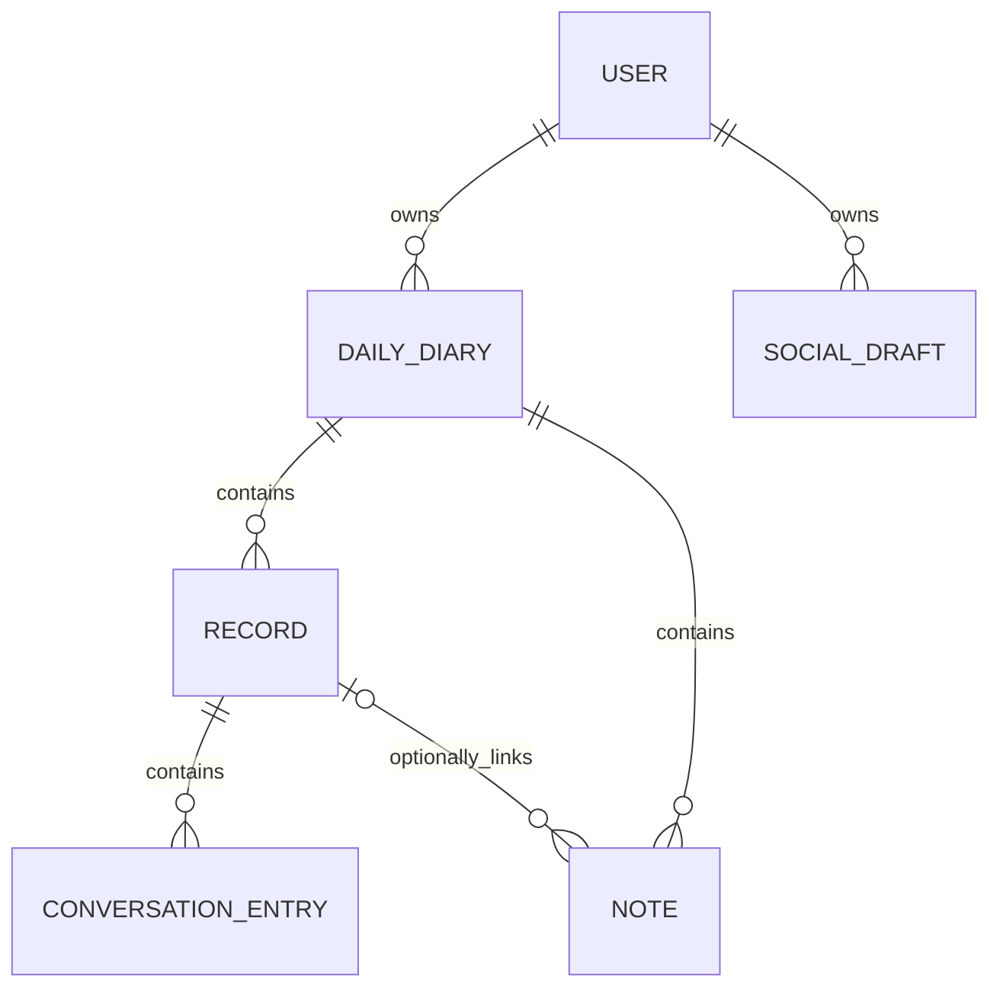

# MyDawnDiary — data model draft

This records the agreed core data model for the first backend phase. The initial schema and API code are now in `backend/`; AI and speech integrations remain open.

## Quick guide: notes, conversations, and diaries

- **Note:** Something the user chooses to write down. It can stand alone or be linked to a conversation.
- **Conversation (record):** One actual talk with AI, by text or voice. Voice becomes a text transcript; raw audio is not saved. One conversation equals one record.
- **Daily diary:** The single diary for one user on one calendar day. It groups that day's notes and conversations. A day can contain many notes and conversations, but only one daily diary. Later, it will also have one AI-written combined entry about the day.

In short: **notes and conversations are the individual items; the daily diary groups them by day.**

## Core relationships

**Confirmed:** one record represents exactly one saved AI conversation. A user can own many records, and each record contains that conversation's entries in order.

**Confirmed:** a user can also save a freeform text note independently of any AI conversation. A note does not require a record.

**Confirmed:** personal notes are private to their owner. Other user accounts cannot view or change them.

**Confirmed:** records and notes enter a recycle bin when deleted and are permanently removed three days later.

**Confirmed:** each user has at most one diary for a calendar day. That daily diary can contain multiple conversation records and multiple notes. A note may be linked to one conversation or remain unlinked. An unlinked note still belongs to its day's diary; no placeholder conversation is needed.

**Confirmed:** the daily diary includes one AI-written combined entry drawn from that day's conversations and notes. The user may edit the displayed daily entry while the original AI version is preserved. The complete conversations and notes remain available separately; a “Read more” control may expand long content in the interface without shortening the stored text.

## First-release conversation flow

1. The user enables the microphone. Saying **“Dear Diary”** activates the AI interaction.
2. The user speaks with the AI. Speech-to-text produces ordered text entries. The in-progress record is autosaved so an interruption does not lose the conversation. The user may correct a misheard word during live capture before that entry is finalized.
3. When the conversation actually ends, the AI creates a summary and the record is marked complete. Ordinary pauses do not end the conversation or trigger a summary. The user may edit the summary, but cannot edit finalized conversation entries.

The same activation should also let the user create a personal note. Notes are primarily entered manually and may optionally link to a record. Only the transcript is retained; raw audio is not saved. How the app detects the activation phrase and a true end of conversation remains open.

## Core entities

### User

The person who owns private diary content.

| Candidate field | Purpose | Status |
| --- | --- | --- |
| `id` | Stable internal identity | Proposed |
| `email` | Sign-in and account contact | Confirmed |
| `password_hash` | Password verification without storing the password | Confirmed |
| `display_name` | Name shown in the app | Optional |
| `created_at` | Account creation time | Proposed |
| `time_zone` | Determines the user's local diary date | Proposed |

Authentication credentials should be handled separately from diary content. Email and password sign-in is confirmed. Email OTP may be added within a free sending allowance; its exact role (email verification, sign-in, or second factor) is still open.

### Daily diary

The one diary belonging to a user for a calendar day. It groups all of that day's conversations and notes and has one AI-written combined entry. A unique constraint on `user_id` and `diary_date` prevents duplicate diaries for the same day.

| Candidate field | Purpose | Status |
| --- | --- | --- |
| `id` | Stable daily-diary identity | Proposed |
| `user_id` | Owner | Confirmed concept |
| `diary_date` | The day in the account's IANA time zone | Confirmed concept |
| `ai_combined_entry` | Original AI-written daily entry based on that day's conversations and notes | Confirmed concept |
| `edited_combined_entry` | User-edited version, if changed | Confirmed concept |
| `combined_entry_generated_at`, `combined_entry_edited_at` | Generation and last edit times | Proposed |
| `created_at`, `updated_at` | When the daily diary was created and changed | Proposed |

The combined entry adds a readable account of the day; it does not replace the source conversations or notes. When it is first generated and whether later additions regenerate it are open decisions.

### Record

One saved AI conversation belonging to one daily diary, and therefore owned by that diary's user.

| Candidate field | Purpose | Status |
| --- | --- | --- |
| `id` | Stable record identity | Proposed |
| `diary_id` | Parent daily diary | Confirmed concept |
| `title` | User-facing label | Proposed |
| `status` | In progress, complete, or in recycle bin | Confirmed concept |
| `source` | Origin; first-release conversations start in this app | Optional |
| `started_at` | When the interaction began | Proposed |
| `ended_at` | When the conversation actually ended | Proposed |
| `ai_summary` | Original AI-generated summary, preserved after user edits | Confirmed concept |
| `edited_summary` | User-edited version, if changed | Confirmed concept |
| `summary_generated_at`, `summary_updated_at` | Summary creation and last edit times | Proposed |
| `deleted_at` | When moved to recycle bin; permanent purge follows after three days | Confirmed concept |
| `created_at`, `updated_at` | When the record was saved and changed | Proposed |

### Conversation entry

One turn or message inside a record.

| Candidate field | Purpose | Status |
| --- | --- | --- |
| `id` | Stable entry identity | Proposed |
| `record_id` | Parent record | Proposed |
| `position` | Order within the conversation | Proposed |
| `speaker` | User or AI assistant | Proposed |
| `content` | Finalized message text, including speech-to-text output for spoken user turns | Proposed |
| `model` | AI model, if known | Optional |
| `occurred_at` | Original message time, if known | Optional |
| `created_at` | Time saved in MyDawnDiary | Proposed |

Finalized entries are immutable. Corrections to speech recognition happen during live capture, before an entry is finalized. No raw audio field is needed in the first-release model.

### Note

A standalone text entry written by a user, separate from AI conversation records.

| Candidate field | Purpose | Status |
| --- | --- | --- |
| `id` | Stable note identity | Proposed |
| `diary_id` | Parent daily diary and route to its owner | Confirmed concept |
| `record_id` | Optional link to one conversation record; empty means unlinked | Confirmed concept |
| `title` | Optional label | Optional |
| `content` | Primarily manually entered, user-written note text | Confirmed concept |
| `deleted_at` | When moved to recycle bin; permanent purge follows after three days | Confirmed concept |
| `created_at`, `updated_at` | When the note was saved and changed | Proposed |

## Rules to settle

- Each record and its entries are private to their owner unless the user explicitly chooses to publish content.
- Only the note owner can read, edit, or delete that note.
- Define when a live speech-to-text entry becomes final and how a user corrects a misheard word before then.
- Define how the app distinguishes an ended conversation from a pause.
- Define how to resume an interrupted in-progress record.
- Decide whether deleting a record also removes its entries and what happens to linked notes, reviews, and social drafts when the three-day recycle-bin period ends.
- Preserve notes when a linked conversation is permanently deleted; clear the link so those notes become unlinked.
- The first API version links a note only to a conversation in the same daily diary.
- The user chooses an IANA time zone for diary dates. New records and notes may be assigned only to the user's today or yesterday; future dates are disallowed. A conversation crossing midnight remains one record and defaults to its start day, but may be assigned to today or yesterday when completed. Older diaries remain editable.
- The first API version creates a daily diary when its first conversation or note arrives, avoiding empty stored diary rows.
- Decide when the combined entry is first generated and how it is updated when another conversation or note is added that day.
- Define whether the 30-day review uses original conversation times, save times, or both.
- Define how to handle missing provider, model, and timestamp information if import is added later.
- Define the role of email OTP if a free sending service is selected.

## Later entities

Social post drafts are private snapshots of user-approved copy. They may reference a diary, conversation, or note owned by the same user, or have no source. The user must explicitly approve a draft, and approval does not publish it. External publication is deferred until a platform is selected.

The 30-day activity review is computed from diary dates and active source rows, so no separate review table is needed yet. It counts complete conversations, their finalized messages, notes, and active days for today and the preceding 29 days in the user's time zone. AI-written personality review is deferred until the AI integration discussion.

## Confirmed decision

**One record = one AI conversation.** A record does not group multiple conversations.
